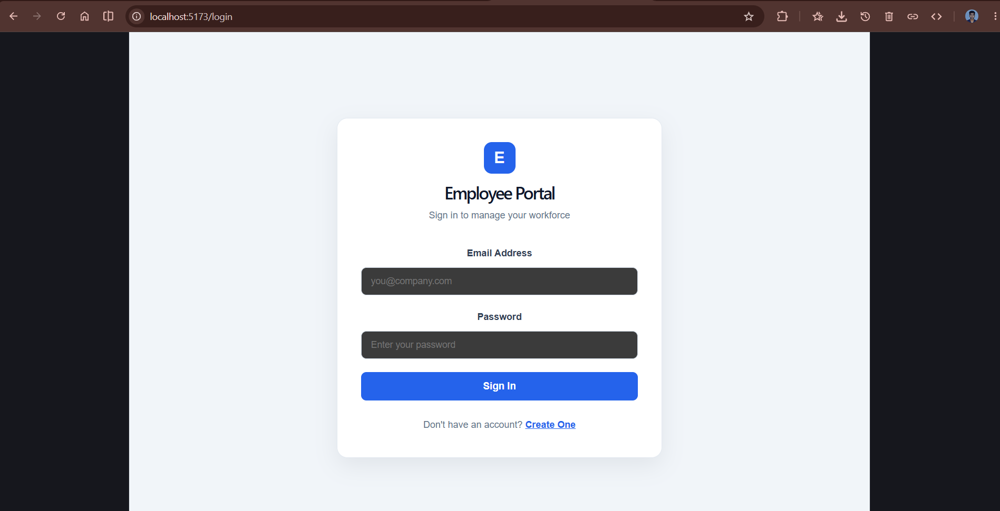
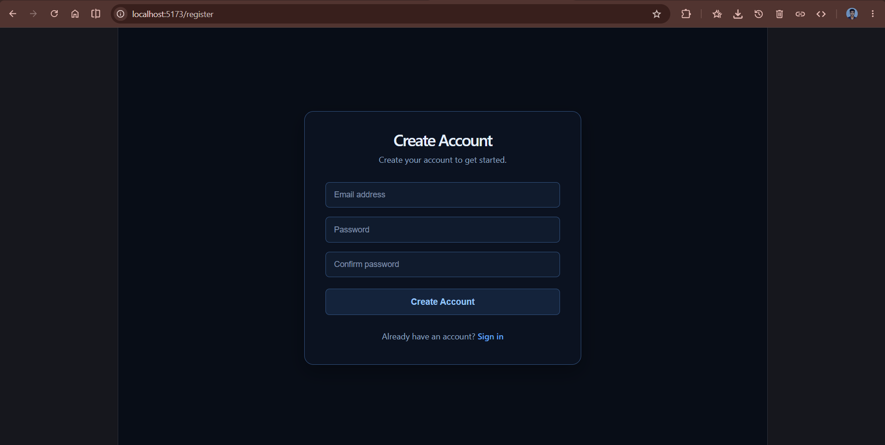
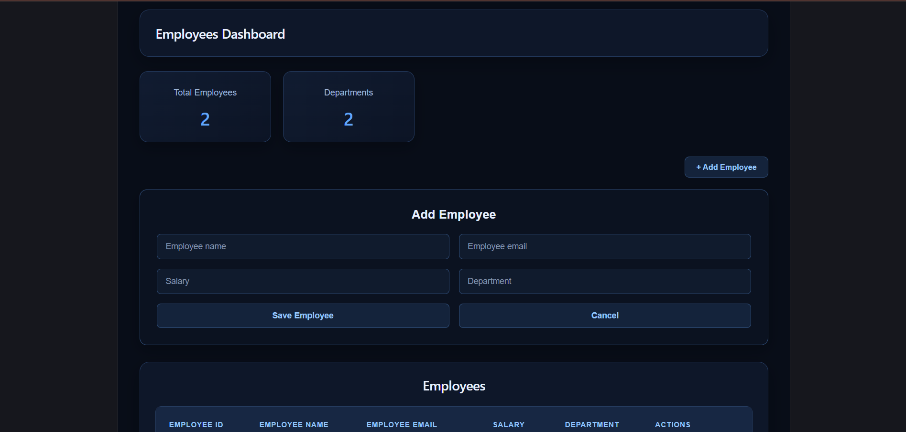
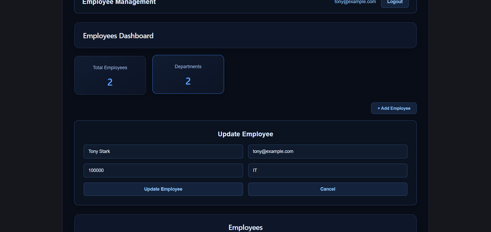
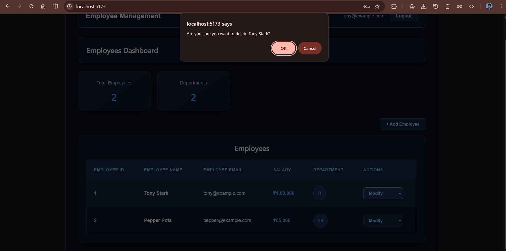

# Employee Management System

A full-stack Employee Management System built with React, Spring Boot, and PostgreSQL. This project demonstrates frontend and backend integration, REST API development, database operations, and JWT-based authentication.

## Overview

The application provides an interface for managing employee records through a React frontend connected to a Spring Boot backend.

## Technology Stack

| Layer | Technologies |
|---|---|
| Frontend | React, JavaScript, CSS |
| Backend | Java, Spring Boot |
| API | REST APIs |
| Database | PostgreSQL |
| Authentication | JWT |
| Build Tool | Gradle |
| Version Control | Git, GitHub |

## Features

- User registration and login
- JWT-based authentication
- Protected dashboard routing
- View employee records
- Add new employees
- Update existing employee details
- Delete employee records
- Sort employees by ID
- Employee data persistence using PostgreSQL

## Project Structure

```text
employee-management-system/
├── employee-frontend/
│   ├── src/
│   ├── public/
│   ├── package.json
│   └── package-lock.json
│
└── employee-service/
    ├── src/
    │   └── main/
    │       ├── java/
    │       └── resources/
    │           └── application.properties
    ├── gradle/
    │   └── wrapper/
    ├── build.gradle
    ├── settings.gradle
    ├── gradlew
    └── gradlew.bat
```

## Prerequisites

Before running the application, install:

- Java version compatible with the backend project
- Node.js and npm
- PostgreSQL

## Getting Started

### 1. Clone the repository

```bash
git clone https://github.com/harshavardhanbonda/employee-management-system.git
cd employee-management-system
```

### 2. Configure the database

Create a PostgreSQL database for the application.

Configure the following environment variables for the backend:

- `DB_URL` — PostgreSQL JDBC connection URL
- `DB_USERNAME` — PostgreSQL username
- `DB_PASSWORD` — PostgreSQL password
- `JWT_SECRET` — Secret used for JWT signing

The backend's `application.properties` should reference these environment variables rather than contain actual credentials.

### 3. Run the backend

Open a terminal in the `employee-service` directory.

On Windows PowerShell:

```powershell
.\gradlew.bat bootRun
```

On macOS or Linux:

```bash
./gradlew bootRun
```

Make sure PostgreSQL is running and the required environment variables are configured before starting the backend.

### 4. Run the frontend

Open another terminal in the `employee-frontend` directory.

Install dependencies:

```bash
npm install
```

Start the development server:

```bash
npm run dev
```

Open the local URL displayed in the terminal by Vite.

## Security Notes

- Do not commit database passwords, JWT signing secrets, or other sensitive credentials.
- Configure authentication secrets through environment variables.
- The backend must validate JWTs and enforce authorization on protected API endpoints.

## Future Improvements

Potential enhancements include:

- Employee search and filtering
- Pagination
- Automated tests
- Application deployment
- Improved input validation and error handling

## Author

**Bonda Harsha Vardhan**

Java Full-Stack Developer

[GitHub Profile](https://github.com/harshavardhanbonda)


## Application Screenshots

### Login


### Registration


### Employee Dashboard


### Add Employee


### Update Employee


### Delete Employee


